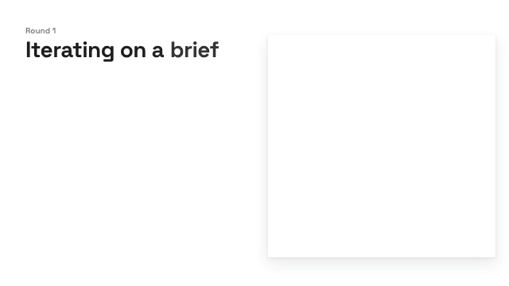

# ⏚ autoground

autoground is an <ins>informal</ins> proof assistant that helps your agents ground
explanations in the reality of your codebase.

At the speed agents are moving, any dormant misunderstandings you have with your human or
machine collaborators get amplified much more quickly than before. LLMs also happily juggle
different names for the same concept, even if one is given in the codebase. Before you know
it, your mental model is drifting further and further from what is actually implemented, and
the explanations your agents are supplying no longer seem to *click*.

autoground gives you a language to (re-)establish shared terminology and an informal proof
checker that helps build and maintain trust in any statement you or your agents make about
the codebase.

Unlike formal proof assistants like Lean or Rocq, autoground uses a [system one
model](https://typesafe.ai/blog/introducing-system-one-models-and-jev) as its proof kernel,
which has all kinds of wacky implications. The kernel accepts any deductive step that a
capable LLM can follow *intuitively*, meaning without the use of reasoning tokens. The trust
boundary shifts: it becomes easier for you to verify assumptions and claims made throghout
the proof, but the informal and non-deterministic nature of the approach admits both false
positives and negatives.

We think that once the [uneasy feeling
passes](https://en.wikipedia.org/wiki/Proofs_and_Refutations), this opens up some
interesting possibilities to explore over time.

> [!WARNING]
> *autoground is little more than an experiment at this point.*


## Installation prompt

```
Please clone https://github.com/comnik/autoground.git and run `make install` from the repo root. This will install the autoground binary itself, along with the `/brief` and `/verify` skills.

If a [TypeSafe API key](https://docs.typesafe.ai/introduction) is not available as `TYPESAFE_API_KEY` in the environment, then prompt the user to set one up. Explain to the user that autoground incurs API usage. By default, all commands are capped at a budget of 1 cent.

Confirm that everything is working, by validating this README via `autoground check README.md` from the repo root.

Conclude by listing the installed skills and offering to the user to try running `autoground check README.md` on their own, just to see it in action once.
```

> [!NOTE]
> Using autoground requires a [TypeSafe API key](https://docs.typesafe.ai/introduction) to
> be available as `TYPESAFE_API_KEY` in your environment. Every use of autoground incurs API
> usage. By default, all commands are capped at a budget of 1 cent.

<!--
```brief
(ns readme)

(claim "check runs with the default budget cap by default"
  (witness "src/main.rs"))

(claim "the default budget cap is 1 cent"
  (witness "src/oracle/jev.rs"))
```
-->

After the installation, run `autoground check README.md` if you want to see autoground in
action for yourself.


## Get started

With the autoground CLI and skills installed, you're all set to build up a grounded mental
model for any codebase, using the `/brief` skill. Chances are that you are entirely
unfamiliar with the autoground codebase, so we'll use that as an example.

Start a session in the autoground repository you just cloned and tell your agent what aspect
of autoground you are trying to build an understanding of:

```
/brief me on the autoground architecture
```

What your agent will produce in response to this, most likely doesn't help you much. The
resulting brief and accompanying diagram will put key concepts next to random function
names, or include elaborate networks of relationships that describe a secondary mechanism
like pretty printing of results.

This is expected! You didn't have the vocabulary to ask a precise question yet, and so the
agent is working on behalf of a superposition of possible audiences. Creating a `/brief`
that is useful to you is an iterative process:

1. Establish shared terminology: what concepts are we talking about?
2. Validate relationships: how do these concepts relate in the codebase?
3. Detect mis-alignment: where do nominally identical concepts relate in different ways?
4. Take corrective action, either by updating your mental model or by instructing your
agents to change the code to match it.
5. Shift or refine focus, then rinse and repeat.

Here is what that process could look like
([YouTube](https://www.youtube.com/watch?v=lJeqCtzWWmo)):

[](https://www.youtube.com/watch?v=lJeqCtzWWmo)

As boring as it may sound, getting to an accurate mental model requires consistent names and
precise relationships. Just think of your last whiteboarding session with a human colleague:
first you agree on how to label the boxes, then you debate every arrow.

This human-in-the-loop process takes time and burns tokens. autoground is meant to increase
trust in the outcome, by enforcing precise and verifiable claims. Once created, a brief can
be re-verified cheaply by running `autoground check`, so you won't have to redo the entire
exercise anytime someone lands a change to the repository.


## The `brief` language

Informal proof is a dynamic process where proof author and verifier iteratively align their
respective mental models and expose implicit assumptions. Aligning mental models requires
using the same name for things that relate in the same way. brief is a language with two
goals: 1) help establish shared terminology, and 2) support gradual decomposition of a
complicated argument into increasingly atomic claims.

> **[brief](https://www.merriam-webster.com/dictionary/brief)**<br/>
> *"a formal written presentation of an argument that sets forth the main points with
> supporting precedents and evidence"*

The language grammar and constructs are [explained in the docs](/docs/brief/language.md),
which are also included in the installed skills.

I suspect you'll rarely deal with the raw syntax without an agent intermediating, but take a
look at the autoground [architecture brief](/briefs/architecture/architecture.brief) if you
like. Most of the time, your agent should be handing you your preferred visual
representation to look at, see below.


## Verification with `check`

```
autoground check briefs/architecture/architecture.brief
```

Briefs compile to a set of inter-dependent claims, which `check` then validates starting
from the referenced witnesses.

At every step in the proof the oracle is provided with the collected support (witnesses or
other claims) and is asked to judge the proposed conclusion as "supported", "contradicted",
or "neutral". Every `claim` is a deductive step. Only logical operators are resolved
deterministically, without involving the oracle. Each unique claim is only proved once, no
matter how often it is referred to.

Exit status is 0 when every top-level claim is discharged, 1 otherwise, and 3 on a compile,
IO, or oracle failure. Each check writes a detailed trace of all proof steps along with the
requests sent to the oracle.

To illustrate this flow, an agent created the below diagram based on the [architecture
brief](/briefs/architecture/architecture.brief). Each node and each arrow is backed by
witnesses from the autoground source code. All briefs are checked during pre-commit, so any
drift between implementation and diagram will be caught immediately.

