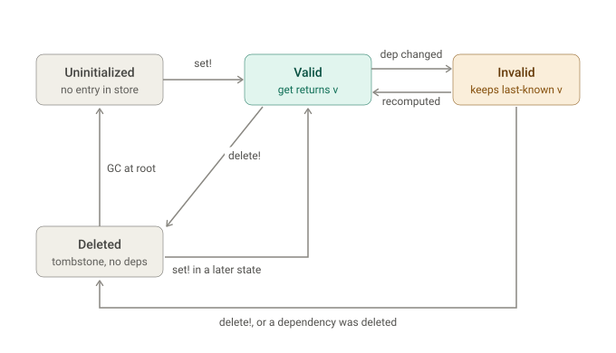

# Grounded explanations with `/brief`

At the speed agents are moving, any dormant misunderstandings you have with your human or
machine collaborators get amplified much more quickly than before. As a result, your mental
model of the system frequently drifts from what is actually implemented.

Asking agents to fill in the gaps in your understanding often takes a surprising amount of
energy on your part. The explanations they are supplying don't seem to *click*. There are
probably several reasons for this, but one is that agents don't mind juggling different
terminology for the same concept, making it harder for you to place the provided information
in your existing mental model.

### An example

On a real codebase that implements a caching system called *Arroyo*, we ask Opus 5.5
(medium) a simple question:

> Please explain and visualize the state machine of an Arroyo StoreValue

In response to which it produces this diagram:



Now, superficially this looks pleasant and reasonable. However on a closer look, things
start to get fuzzy:

1. `Uninitialized` is not actually a state. The cache API just returns an "uninitialized"
   marker for keys that don't exist at all, or those that have been explicitly tombstoned
   (the `Deleted` state). To clients, `Uninitialized` is indistinguishable from `Deleted`.
2. The "set! in a later state"-transition from `Deleted` to `Valid` is imprecise, as derived
   values can be updated in the same state as well.
3. The transitions into the `Deleted` are labeled inconsistently: "delete!" and "delete!, or
   a dependency was deleted". Deletions propagate transitively through the dependency chain
   in both cases.

### Using autoground and the `/brief` skill

Now the same thing with autoground and the `/brief` skill:

> /brief me on the state machine of an Arroyo StoreValue

This time, Opus 5.5 (medium) produces the following diagram along with an underlying
`arroyo-storevalue.brief`:


The minor differences in aesthetics and layout are not the point. Notice instead how the
agent correctly introduced a `NoStoreValue` state, rather than using the misinterpreted
`Uninitialized`. The explanation of the `Deleted` -> `Valid` transition reads *"revives:
set_input! stores a new valid value for a deleted key. set_internal! allows this even in the
state that deleted the key."*, which correctly mentions updates in the current state.
Transitions are labeled consistently. The imprecise transitions to `Deleted` from above now
are explained as *"deletes: delete! stores a deleted tombstone without dependencies, and
cascades to keys that depend on it (except Maintainable values)."*.

Peeking at the underlying `arroyo-storevalue.brief`, we see the relevant names declared.

```clojure
(name valid)            ;; Validity members
(name invalid)
(name deleted)
(name invalidated)      ;; MissingValueReason members, returned by get(s, k)
(name uninitialized)

(sense NoStoreValue "without a StoreValue (get_storevalue returns nothing)")
```

There is no identifier for the absence of a value in the code, so Opus introduced
`NoStoreValue` as a definition (refer to the [language docs](/docs/brief/language.md) to
learn more). Opus calls this out explicitly in its response:

> One point of terminology first. A StoreValue itself never changes state: it’s an immutable
> struct with v, validity, deps and dep_values. What has a state machine is a key’s binding
> in a state. Each transition stores a new StoreValue in some node, and a state sees the
> newest one among the nodes in its view (get_storevalue). In the brief, “a key that is
> invalid” means exactly that.

> States: no StoreValue yet, valid, invalid and deleted. Readers never see Validity
> directly: to_value maps invalid to invalidated, and deleted or a missing StoreValue to
> uninitialized.

Next, the brief captures the appropriate relationships

```clojure
(sense assigns "for a key that is {From}, set! of a mutable state stores a new StoreValue that is {To}")
(sense recomputes "get! calls the user function for a key that is {From} and stores its result with set!, after which the key is {To}")
(sense revives "set_input! of a mutable state stores a new StoreValue for a key that is {From}, after which the key is {To}")
(sense invalidates "invalidate_if_valid_internal! replaces the StoreValue of a key that is {From} by one that is {To}")
(sense deletes "delete! replaces the StoreValue of a key that is {From} by one that is {To}")
(sense collected "when the tombstone of a key that is {From} reaches the root node, maintain_parent! removes the key from the root node's store, so the key is {To} there")
(sense reads_as "to_value, which get(s, k) returns, maps a key that is {State} to {Reading}")
```

The remainder of the brief are a bunch of claims like

```clojure
(claim "StoreValue is declared as a struct, not a mutable struct, with the fields v, validity, deps and dep_values"
  (witness "../../../packages/Arroyo/src/Arroyo.jl"))

(claim "the Validity of a StoreValue is valid, invalid or deleted, and the v of an invalid StoreValue is the last known valid value"
  (witness "../../../packages/Arroyo/src/Arroyo.jl"))

(claim "set_internal! stores a new StoreValue with the validity it is given as node.store[k] of a leaf node"
  (witness "../../../packages/Arroyo/src/Arroyo.jl"))

(claim "set! of a state calls set_internal! with validity valid"
  (witness "../../../packages/Arroyo/src/Arroyo.jl"))
```

building up to one claim for each state transition

```clojure
(claim (deletes valid deleted)
  (and
    "the Validity of a StoreValue is valid, invalid or deleted, and the v of an invalid StoreValue is the last known valid value"
    "delete! requires the key to have a StoreValue whose validity is not deleted"
    "delete! calls set_internal! for the key with validity deleted and no dependencies"
    "set_internal! stores a new StoreValue with the validity it is given as node.store[k] of a leaf node"))
```

If we're willing to spend another fraction of a cent, we can validate the brief ourselves:

```shell
trace available at /tmp/autoground/1794264702414896000-21108-0/trace.jsonl
throughput ▃▄▄▄▄▄▄▄▄▄▄▃▂▂▂▂▂▂▂▂▁▁▁▁  7 requests averaging 4.7/16
latency    █▃··▃▃▃  p50 223ms  p95 383ms  p99 395ms
utilization batch=4.7% fill=44.0%
15/17 claims validated in 410ms for $0.0041 (98k tokens)
```

But Opus is upfront that autoground didn't accept all of the claims and provides additional
arguments for why the two claims still hold. The skill explicitly asks to not make this a
game of tricking the judge.

> The checker never confirmed the two transitions back to valid (invalid → valid and deleted
> → valid).
> I believe they’re correct, for this reason:
>   - set! places a value in the newest node that holds the key or one of its dependencies
 (node_for_last_dependency_change).
>   - That node is at or after the node holding the invalid or deleted StoreValue, so the
new valid one is what get_storevalue returns.
>   -  I nearly concluded otherwise until I read that node_for_last_dependency_change counts
the key itself, not just its dependencies. The brief says this in a comment instead of
rewording the claims until the checker gives in.

Checking a brief is cheap enough to run in CI or like a linter, quickly alerting us when our
newly restored mental model no longer matches the code.

### Takeaways

Using `/brief` is not some magic bullet for agents to oneshot an accurate explanation
guaranteed to give you an aha moment. autoground is effectively just a way to get agents to
care more about the hardest problem in software engineering: naming.

Because it relies on a system one model, autoground incurs negligible cost when compared to
the cost of running your agent. Rarely more than a few cents per session. Catching even a
single misplaced arrow in the architecture diagram that your entire team is working off of
will be more than worth it.

Give it a try and [reach out on X for support](https://x.com/NikolasGoebel).